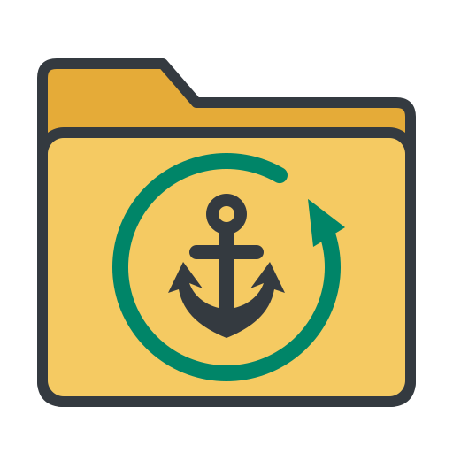
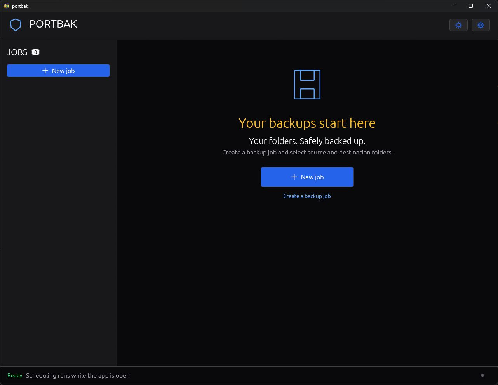
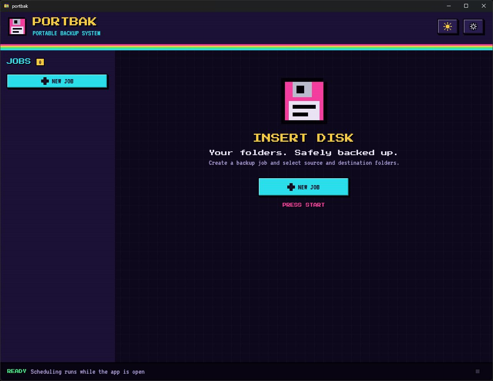
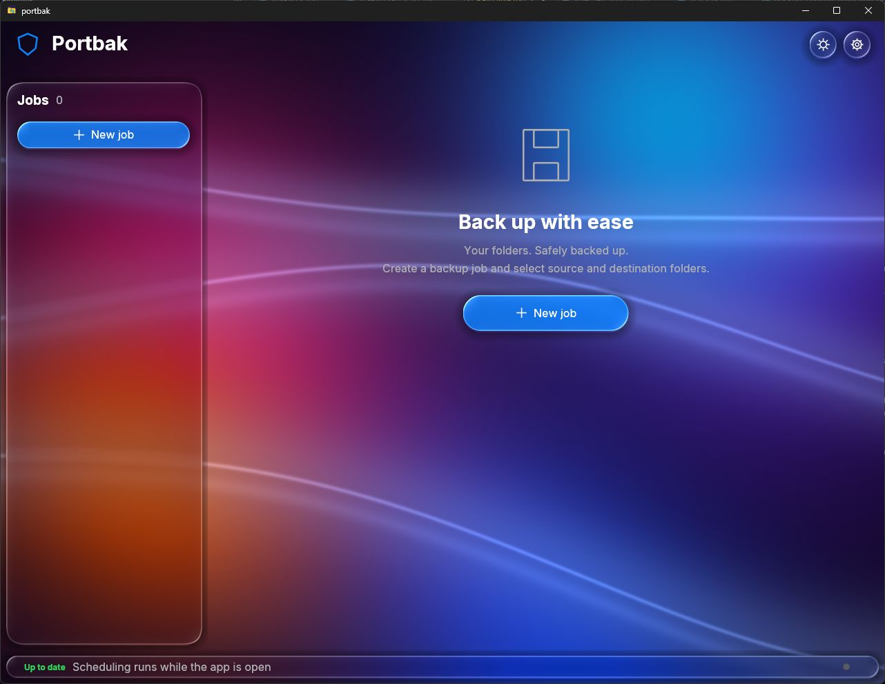
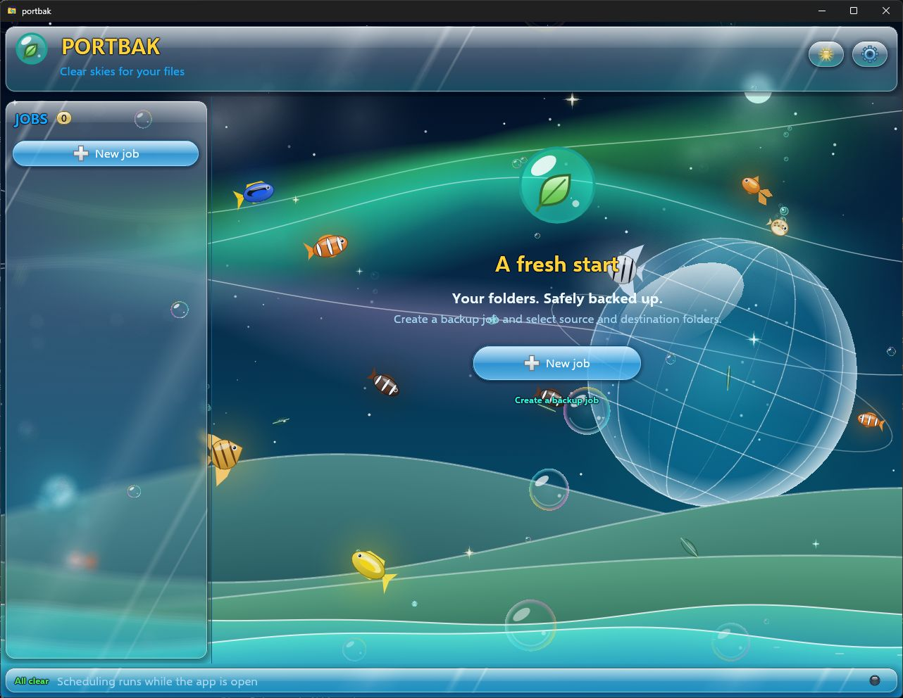
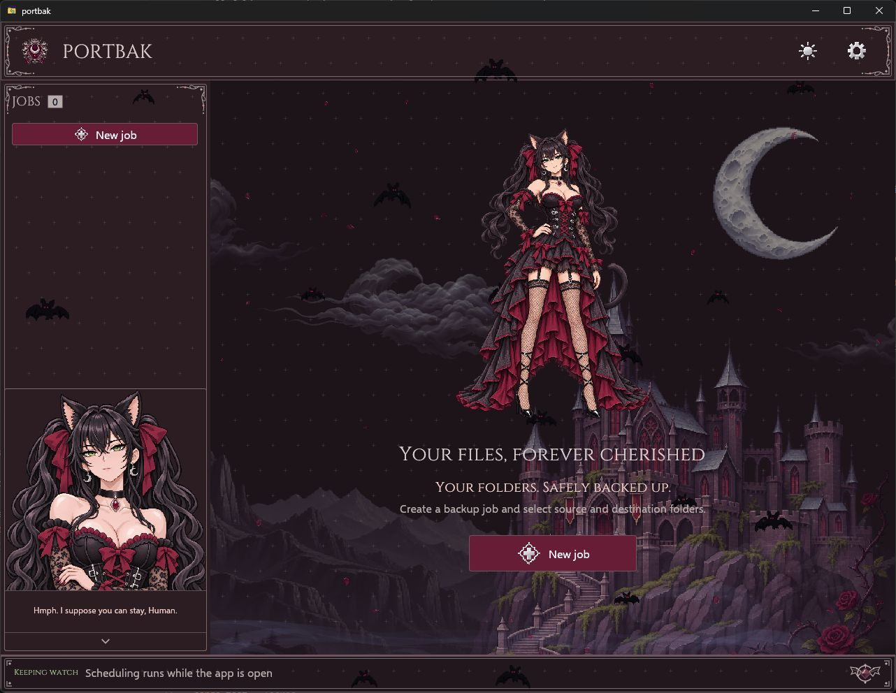

# portbak 

Portable desktop backups for Linux x86-64 and Windows 10/11 x86-64. No installer, server, or account required.

[](assets/screenshots/modern-dark.png)

| Retro | Liquid Glass | Frutiger Aero | Moonveil |
| :---: | :---: | :---: | :---: |
| [](assets/screenshots/retro-dark.png) | [](assets/screenshots/liquid-glass-dark.png) | [](assets/screenshots/frutiger-aero-dark.png) | [](assets/screenshots/moonveil-dark.png) |

- Full folder or ZIP backups, created only when source contents change.
- Manual checks or automatic interval, daily, and weekday schedules.
- Retention limits by count or size, with protected versions.
- Built-in restore and five looks with light and dark modes.

## Getting started

Download and extract the archive for your platform from [GitHub Releases](https://github.com/andi-di/portbak/releases/latest). To upgrade, close the app and replace its executable; keep your settings and backups.

1. Put the executable in a **writable folder** and launch it. On Linux, run `chmod +x portbak` if needed.
2. Select **New job**, choose a source folder, and use the automatic destination or choose your own.
3. Select **Check now** to create your first backup. Enable automatic backups to use the schedule.
4. Open the job’s **Backups** tab to restore or protect saved versions.

**Scheduled backups require the app to stay running.** Minimize it to keep backing up; closing it terminates running operations.

Settings are saved in `portbak.json` beside the executable. To move the app with automatic destinations, move the executable, configuration, and `backups` folder together. Manual paths remain absolute. Removing a job does not delete its backups.

## Before backing up or restoring

- Restore replaces **all current contents of the source folder**. Close programs writing to it first. You can also recover files by copying a backup folder or extracting a ZIP.
- Backups are verified during creation, but are not filesystem snapshots. Export active databases or close the applications using them.
- Links, junctions, and special files are skipped. File metadata is not fully preserved, and backups are not encrypted.
- Retention keeps the latest successful backup and protected versions. Space for a new full backup is needed before cleanup.
- The trash button permanently deletes an unlocked backup **without confirmation**.

Linux requires a graphical session, working OpenGL drivers, and standard X11/Wayland libraries. Folder selection uses XDG Desktop Portal; opening folders requires `xdg-open`.

## Build

Install Rust 1.92 or newer and your platform’s build tools, then run:

```sh
cargo build --release --locked
```

The executable is `target/release/portbak` on Linux or `target/release/portbak.exe` on Windows.

On Debian/Ubuntu, install build dependencies with:

```sh
sudo apt install build-essential pkg-config libx11-dev libxi-dev libxrandr-dev libxcursor-dev libxinerama-dev libxkbcommon-dev libwayland-dev libgl1-mesa-dev
```

On Windows, use the MSVC Rust toolchain and Visual Studio C++ Build Tools with the Windows SDK.

Before submitting changes, run:

```sh
cargo fmt --check
cargo test --locked
cargo clippy --locked --all-targets -- -D warnings
```

See [AGENTS.md](AGENTS.md) for contribution rules.
